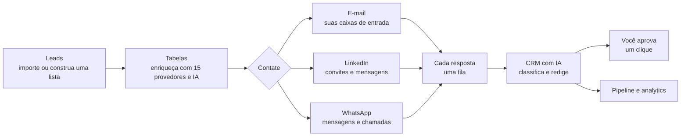
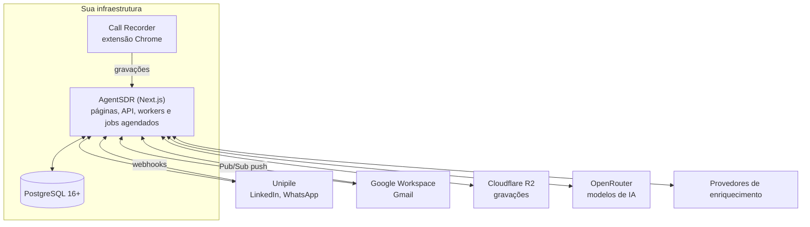

<div align="center">

  

<h3>Encontre leads, alcance-os por e-mail, LinkedIn e WhatsApp,<br>e deixe a IA trabalhar cada resposta — tudo num workspace que você hospeda.</h3>

<p>
  
  &nbsp;·&nbsp;
  <a href="https://github.com/fabicarvano/AgentSDR/discussions"><b>Discussões</b></a>
  &nbsp;·&nbsp;
  <a href="https://github.com/fabicarvano/AgentSDR/issues/new?template=bug_report.yml"><b>Reportar bug</b></a>
</p>

<p>
  <a href="LICENSE"></a>
  <a href="https://github.com/fabicarvano/AgentSDR/stargazers"></a>
  <a href="https://github.com/fabicarvano/AgentSDR/discussions"></a>
  
  
</p>

</div>

<br>

<div align="center">
  <a href="docs/assets/video/agentsdr-film.mp4">
    
  </a>
  <br>
  <sub>Respostas de todos os canais chegam numa fila única. A IA classifica cada uma e redige a resposta. <a href="docs/assets/video/agentsdr-film.mp4">Assista ao filme de 51 segundos</a>. Todos os nomes são fictícios.</sub>
</div>

## Por que AgentSDR

Outbound normalmente significa juntar banco de leads, ferramenta de enriquecimento, sequenciador de e-mail, ferramenta de LinkedIn, discador e CRM — cada um com suas próprias licenças, sua própria cópia dos leads e sua própria visão de quem respondeu.

- **Um workspace no lugar de seis ferramentas.** Um registro por pessoa e empresa, então uma resposta no LinkedIn aparece na mesma fila e pipeline que uma resposta por e-mail.
- **A IA faz o acompanhamento.** Cada resposta, em cada canal, é lida, classificada e recebe uma resposta redigida. Você aprova o que sai.
- **Trabalhe por chat.** Conecte o Claude, Claude Code ou qualquer cliente MCP e trabalhe a fila de *Ação necessária* a partir daí.
- **Você é o dono.** Um único app Next.js e um banco PostgreSQL no seu servidor. Seus leads, conversas e gravações nunca saem da infraestrutura que você controla.
- **Suas chaves, sem licenças por usuário.** Conecte seu próprio Google Workspace, Unipile, storage e qualquer modelo de IA no OpenRouter. Sem taxas por usuário ou por contato: você paga o servidor e seus provedores.

## Tudo em um workspace

<table>
  <tr>
    <td width="50%" valign="top">
      
      <p><b>Três canais, um registro de lead.</b> E-mail das suas próprias caixas de entrada, convites e mensagens do LinkedIn, chats e chamadas do WhatsApp. Como se encaixa →</p>
    </td>
    <td width="50%" valign="top">
      
      <p><b>Enriquecimento integrado.</b> Tabelas executam 15 provedores (Apollo, Hunter, Lusha e mais), colunas de IA e chamadas HTTP, linha por linha. Tabelas →</p>
    </td>
  </tr>
  <tr>
    <td width="50%" valign="top">
      
      <p><b>Sequências de e-mail das suas caixas de entrada.</b> Google Workspace, campos de mesclagem, janelas de envio e limites diários que mantêm as caixas saudáveis. E-mail →</p>
    </td>
    <td width="50%" valign="top">
      
      <p><b>Convites e mensagens no LinkedIn.</b> Pedidos de conexão com notas, follow-ups após aceite, dentro de limites diários conservadores. LinkedIn →</p>
    </td>
  </tr>
  <tr>
    <td width="50%" valign="top">
      
      <p><b>Chats e chamadas gravadas no WhatsApp.</b> Campanhas de mensagem e chamadas feitas pelo AgentSDR, gravadas no seu bucket e transcritas. WhatsApp →</p>
    </td>
    <td width="50%" valign="top">
      
      <p><b>A IA lê cada resposta.</b> Interessado, reunião solicitada, agora não, fora do escritório: classificado com o motivo mostrado e um rascunho pronto. CRM com IA →</p>
    </td>
  </tr>
  <tr>
    <td width="50%" valign="top">
      
      <p><b>Aprove e envie com um clique.</b> Edite o rascunho se quiser; ele sai pelo canal em que o lead escreveu. Nada é enviado sozinho. Rascunhos →</p>
    </td>
    <td width="50%" valign="top">
      
      <p><b>Um pipeline que se mantém atualizado.</b> Cada lead fica onde está e as sequências de follow-up são agendadas automaticamente. Pipeline →</p>
    </td>
  </tr>
  <tr>
    <td width="50%" valign="top">
      
      <p><b>Veja o que se transforma em reuniões.</b> Respostas, respostas positivas, reuniões e clientes, por canal e ao longo do tempo. Analytics →</p>
    </td>
    <td width="50%" valign="top">
      
      <p><b>Self-host em minutos.</b> Baixe um arquivo, configure alguns secrets, <code>docker compose up -d</code>. Sem Redis, sem servidor de fila. Self-hosting →</p>
    </td>
  </tr>
</table>

Também inclui: banco de leads com campos customizados, importação CSV e XLSX com campos de mesclagem, Não Contatar em todos os canais, organizações com papéis, equipes e convites, e regras de envio por organização com padrões seguros.

## Compatível com

<p align="center">
  &nbsp;&nbsp;&nbsp;
  &nbsp;&nbsp;&nbsp;
  &nbsp;&nbsp;&nbsp;
  &nbsp;&nbsp;&nbsp;
  &nbsp;&nbsp;&nbsp;
  &nbsp;&nbsp;&nbsp;
  <picture><source media="(prefers-color-scheme: dark)" srcset="docs/assets/readme/logos/openrouter-dark.svg"></picture>&nbsp;&nbsp;&nbsp;
  &nbsp;&nbsp;&nbsp;
  &nbsp;&nbsp;&nbsp;
  &nbsp;&nbsp;&nbsp;
  &nbsp;&nbsp;&nbsp;
  
</p>

<p align="center"><sub>Cada organização conecta suas próprias contas em Configurações, com setup guiado para cada campo. Todas as integrações →</sub></p>

| Serviço | Função | Guia de setup |
|---|---|---|
| Google Workspace | Envio e leitura do Gmail via service account | Google Workspace |
| [Unipile](https://www.unipile.com) | Contas LinkedIn e WhatsApp, mensagens e chamadas | Unipile |
| [Cloudflare R2](https://www.cloudflare.com/developer-platform/r2/) | Gravações de chamadas e fotos de contato | Cloudflare R2 |
| [OpenRouter](https://openrouter.ai) | Todos os recursos de IA, com sua chave e qualquer modelo | OpenRouter |
| 15 provedores de enriquecimento | Colunas de tabelas | Provedores de enriquecimento |
| [Resend](https://resend.com) | E-mail de cadastro, redefinição de senha e convite | Resend |

<a id="quick-start"></a>

## Como começar

Você precisa de uma máquina com Docker.

```sh
mkdir agentsdr && cd agentsdr
curl -O https://raw.githubusercontent.com/fabicarvano/AgentSDR/main/docker-compose.yml
docker compose up -d          # PostgreSQL, app na porta :3000
```

Abra http://localhost:3000: a página de setup cria sua conta admin e organização. Depois conecte seus serviços em **Configurações**. Para um servidor, substitua os valores `# CHANGEME` no `docker-compose.yml` primeiro; `openssl rand -hex 32` gera um secret.

O guia Docker Compose explica cada configuração e cada serviço. Há também guias para rodar do código-fonte e deploy em produção.

<details>
<summary><b>Rodar do código-fonte</b></summary>
<br>

Você precisa do [Bun](https://bun.sh) 1.2+ e PostgreSQL 16+.

```sh
git clone https://github.com/fabicarvano/AgentSDR.git && cd AgentSDR
bun install
createdb agentsdr
cp .env.example .env.local   # configure DATABASE_URL, BETTER_AUTH_SECRET, INTEGRATION_CREDENTIALS_KEY
bun run db:setup             # cria o schema no banco vazio
bun run db:seed:demo         # opcional: uma organização de demo fictícia
bun run dev                  # http://localhost:3000
```

Com o seed de demo, entre como `demo@example.com` / `demo-password-123`.
</details>

<details>
<summary><b>Variáveis de ambiente</b></summary>
<br>

As variáveis de ambiente cobrem apenas o que o app precisa antes de ler o banco. Todo o resto é por organização, dentro do app.

| Variável | Obrigatória | Função |
|---|---|---|
| `DATABASE_URL` | sim | String de conexão PostgreSQL 16+ |
| `BETTER_AUTH_SECRET` | sim | Assina sessões |
| `BETTER_AUTH_URL` | sim | URL pública, lida em runtime |
| `INTEGRATION_CREDENTIALS_KEY` | sim | Criptografa credenciais de integração (AES-256-GCM) |
| `UNSUBSCRIBE_SECRET` | para e-mail | Assina links de descadastro |
| `CRON_SECRET`, `OUTREACH_TICK_SECRET` | não | Apenas para chamar endpoints de job externamente |
| `RESEND_API_KEY`, `AUTH_EMAIL_FROM` | em produção | E-mail de autenticação via Resend |
| `AUTH_SIGNUP` | não | `invite-only` (padrão) ou `open` |
| `GOOGLE_CLIENT_ID`, `GOOGLE_CLIENT_SECRET` | não | "Continuar com Google" |
| `DB_POOL_MAX` | não | Tamanho do pool de conexões (padrão 8) |
</details>

## Como funciona



Um único app Next.js e um banco PostgreSQL: páginas, rotas de API e workers em background rodam num único processo, sem servidor de fila ou Redis. Cada requisição, job e webhook roda dentro do escopo de uma organização.

<details>
<summary><b>Diagrama de arquitetura</b></summary>
<br>


</details>

<details>
<summary><b>Estrutura do projeto e desenvolvimento</b></summary>
<br>

```
src/app/                 Páginas (App Router) e rotas de API
src/lib/<domain>/        Lógica de negócio, schema e queries por domínio
src/components/          Componentes React, uma pasta por domínio
src/jobs, src/functions  Motor de envio do LinkedIn
src/services/            Clientes da API Unipile
db/                      schema.sql (snapshot gerado) e seed.sql
scripts/                 Histórico de migrations, auditorias, ferramentas de banco, checks e2e
extensions/whatsapp-recorder/   Extensão Chrome que liga e grava chamadas WhatsApp
docker/, docker-compose.yml     Self-hosting
docs/                    Documentação
```

| Comando | O que faz |
|---|---|
| `bun run dev` | Inicia o app em http://localhost:3000 |
| `bun run test` | 600+ testes unitários |
| `bun run typecheck` / `bun run lint` | Deve passar antes de cada commit |
| `bun run db:setup` / `db:seed:demo` | Cria o schema / uma organização de demo fictícia |
| `bun run db:check` | Audita que toda tabela tem escopo por organização |

**Construído com** [Next.js 16](https://nextjs.org) e React 19, TypeScript, [Drizzle ORM](https://orm.drizzle.team), [Better Auth](https://www.better-auth.com), [Tailwind CSS](https://tailwindcss.com) com [AlignUI](https://www.alignui.com) e [Bun](https://bun.sh).
</details>

## Segurança e privacidade

- **Seus dados ficam com você.** Leads, conversas e analytics ficam no seu PostgreSQL; gravações de chamadas no seu bucket R2.
- **Credenciais criptografadas.** Cada chave de API e token salvo é criptografado com AES-256-GCM.
- **Isolamento de tenant, testado.** Uma suite e2e entra como segunda organização e prova que não consegue ver, alterar ou contar nada da primeira.
- **Humanos aprovam respostas de outbound.** Rascunhos aguardam uma pessoa, e o trabalho de outbound pode ser pausado instantaneamente.
- **Reporte vulnerabilidades** via [GitHub security advisories](https://github.com/fabicarvano/AgentSDR/security/advisories/new). Veja [SECURITY.md](SECURITY.md).

## Uso responsável

O AgentSDR contata pessoas em seu nome, então como ele é usado é sua responsabilidade. Os termos do LinkedIn não permitem automação e contas podem ser restritas; o WhatsApp bane números que enviam mensagens em massa não solicitadas; o e-mail frio é regulamentado por leis como CAN-SPAM, GDPR e LGPD; e muitos lugares exigem consentimento antes de gravar uma chamada. Leia Uso responsável antes de começar.

## Perguntas frequentes

<details>
<summary><b>O AgentSDR é gratuito?</b></summary>

Sim. É open source e você hospeda por conta própria, então não há licenças, planos ou taxas por contato. Você paga pelo servidor, pelas contas que conecta (Google Workspace, Unipile) e pelo uso de IA. É licenciado MIT, então você pode usar, modificar e construir sobre ele comercialmente.
</details>

<details>
<summary><b>Quais provedores de e-mail pode enviar?</b></summary>

Caixas de entrada do Google Workspace, conectadas uma vez via service account com delegação em todo o domínio. O Microsoft 365 ainda não é suportado.
</details>

<details>
<summary><b>A automação do LinkedIn vai restringir minha conta?</b></summary>

Nenhuma ferramenta pode garantir isso, mas o AgentSDR fica bem dentro dos limites do LinkedIn: 30 convites por dia em contas premium e 5 em contas gratuitas, intervalo aleatório de 30 a 60 segundos entre convites, horas de trabalho opcionais por conta, e uma conta que atinge o limite do LinkedIn pausa pelo dia.
</details>

<details>
<summary><b>Como funciona a chamada pelo WhatsApp?</b></summary>

Você vincula seu número via Unipile e instala a extensão Chrome AgentSDR Call Recorder. Quando você liga para um lead pelo AgentSDR, a extensão disca dentro do WhatsApp Web e grava os dois lados; a gravação vai para seu bucket de storage e seu modelo escolhido transcreve.
</details>

<details>
<summary><b>Quais modelos de IA posso usar?</b></summary>

Qualquer modelo no OpenRouter, com sua própria chave. Cada chamada é fixada ao provedor que você escolheu, sem fallbacks, então seus dados só vão para onde você escolheu.
</details>

<details>
<summary><b>A IA envia respostas por conta própria?</b></summary>

Não. Rascunhos, incluindo etapas de sequência de follow-up, aguardam em *Ação necessária* até alguém enviá-los, como estão ou editados. Nada sai sozinho.
</details>

<details>
<summary><b>Minha equipe inteira pode usar?</b></summary>

Sim. Convide colegas em Configurações → Membros com o papel de proprietário, admin ou membro. Um deploy também pode ter várias organizações, cada uma completamente separada.
</details>

## Comunidade e suporte

| Onde | Melhor para |
|---|---|
| [GitHub Discussions](https://github.com/fabicarvano/AgentSDR/discussions) | Perguntas, ideias e mostrar o que você construiu |
| [GitHub Issues](https://github.com/fabicarvano/AgentSDR/issues/new/choose) | Bugs e pedidos de funcionalidade |
| [Security advisories](https://github.com/fabicarvano/AgentSDR/security/advisories/new) | Vulnerabilidades, reportadas privadamente |

## Licença

AgentSDR é open source sob a [Licença MIT](LICENSE).

<details>
<summary>Agradecimentos</summary>
<br>

- A fotografia da página de login é de [Marek Piwnicki](https://unsplash.com/photos/w4sxddUJ5-0) no Unsplash.
- Construído com [Next.js](https://nextjs.org), [Drizzle](https://orm.drizzle.team), [Better Auth](https://www.better-auth.com), [AlignUI](https://www.alignui.com) e [Remix Icon](https://remixicon.com).
</details>

<div align="center">
<br>

<br>
<sub>Desenvolvido por <a href="https://github.com/fabicarvano">Fabio Carvano</a> · Se o AgentSDR for útil para você, uma ⭐ ajuda outros a encontrar.</sub>
</div>
